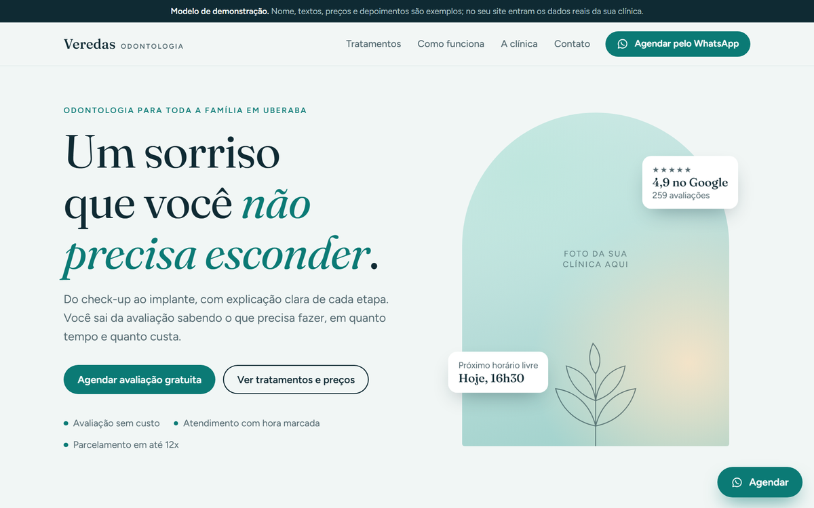

# Veredas Odontologia

Modelo de site para clínica odontológica. A clínica é fictícia: no site de cada cliente entram o nome, as fotos, os tratamentos e os preços reais.

**[Ver o site funcionando](https://uprodigy.github.io/veredas-odontologia/)**

## O que tem no site

- Abertura com chamada para agendar avaliação
- Tratamentos (limpeza, clareamento, implante e outros tratamentos, com preço a partir de) e filtro por categoria
- Passo a passo do atendimento
- Apresentação da profissional e depoimentos
- Perguntas frequentes
- Horários, endereço e botão de WhatsApp fixo na tela
- Funciona no celular, sem nenhuma dependência além das fontes do Google

Feito em HTML, CSS e JavaScript puros, hospedado no GitHub Pages.
